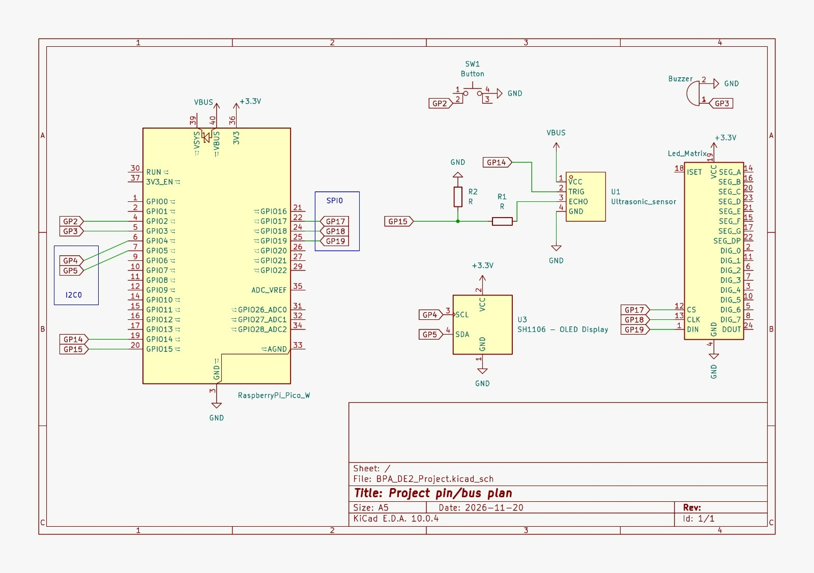

# Ultrasonic Distance Instrument

**Digital Electronics 2 Final Project**
*Raspberry Pi Pico W MicroPython Implementation (Project #6)*

## 1. Problem Statement & Solution Summary

### Problem Statement
Standard distance measurement tools often lack real-time digital readouts, visual proximity warnings, and configurable acoustic alarms. For embedded applications requiring contactless sensing, coordinating multiple data streams (I2C displays, SPI matrices, and precise timing for ultrasonic pulses) without blocking the main execution loop presents a significant architectural challenge.

### Solution
This project implements a fully digital, non-contact Ultrasonic Distance Instrument using the **Raspberry Pi Pico W** running MicroPython. The system features:

- **Real-Time Sensing:** Continuous range measurement using the HC-SR04 ultrasonic transducer.
- **Dual Visual Interfaces:** Precise numeric distance and unit display on a 128x64 SH1106 OLED (I2C), complemented by an intuitive distance gauge on an 8x8 LED Matrix (SPI).
- **Acoustic Alarm:** A frequency-modulated piezo buzzer that triggers when objects cross critical proximity thresholds.
- **Interrupt-Driven UI:** A hardware-debounced tactile push button to instantly toggle between metric (cm) and imperial (inch) units.
- **Cooperative Concurrency:** The entire system relies on the `uasyncio` framework to guarantee non-blocking task execution and responsive interfaces.

---

## 2. Team Members & Contributions

- **Manuel BEAUZOR**
  - **Role:** Hardware Integration & Embedded Development
  - **Responsibilities:** Breadboard circuit assembly, wiring layout, sensor and display hardware integration, MicroPython component coding and physical verification.
- **Romain EON**
  - **Role:** Version Control, Documentation & Software Architecture
  - **Responsibilities:** GitHub repository management, project structure organization, technical documentation (README, Sphinx), driver curation, and `uasyncio` architecture planning.
- **Roberto NATRELLA**
  - **Role:** Embedded Software & Testing Engineer
  - **Responsibilities:** MicroPython firmware and test script development, hardware-software debugging, individual component validation, and system integration.

---

## 3. Project Structure

```text
de2-Ultrasonic-distance-instrument/
├── docs/
│   ├── api/
│   ├── conf.py
│   ├── index.rst
│   └── week1_project6_proposal.pdf
├── images/
│   └── schematic.png
├── src/
│   ├── drivers/
│   │   ├── button.py
│   │   ├── buzzer.py
│   │   ├── led_matrix.py
│   │   ├── oled_sh1106.py
│   │   └── ultrasonic.py
│   ├── utils/
│   │   └── timing.py
│   ├── config.py
│   └── main.py
├── tests/
│   ├── test_button.py
│   ├── test_buzzer.py
│   ├── test_matrix.py
│   ├── test_oled.py
│   └── test_ultrasonic.py
├── README.md
└── requirements.txt
```

---

## 4. Hardware Inventory & Assumptions

### Bill of Materials

| Quantity | Component Description | Interface / Specs | Notes |
| :--- | :--- | :--- | :--- |
| 1x | Raspberry Pi Pico W | RP2040 Dual-Core | 3.3V Logic Level |
| 1x | HC-SR04 Transducer | Digital Pulse | 3.3V/5V Tolerant |
| 1x | 128x64 SH1106 OLED | I2C (Address 0x3C) | Monochromatic Display |
| 1x | 8x8 LED Matrix | SPI (MAX7219) | Visual distance gauge |
| 1x | Piezo Buzzer | GPIO PWM | Active/Passive Alarm |
| 1x | Tactile Push Button | GPIO Input | Unit toggle control |

### Key Assumptions & Limitations
- The system operates entirely on 3.3V logic.
- The ultrasonic sensor requires an unobstructed line of sight to function accurately. Range is hardware-limited (typically 2cm to 400cm).

---

## 5. Wiring Diagram & Pinout Connection

<p align="center">
  <br>
  <em>Figure 1: Full System Interconnect Diagram for Raspberry Pi Pico W and Peripherals.</em>
</p>

### Hardware Pin Mapping Table

| Component | Component Pin | Pico Pin Name | Bus Function | Notes / Signal |
| :--- | :--- | :--- | :--- | :--- |
| **HC-SR04 Sensor** | Trig | GP14 | Digital Out | Trigger pulse |
| | Echo | GP15 | Digital In | Echo width read |
| **SH1106 OLED** | SDA | GP4 | I2C0 Bus | Data line |
| | SCL | GP5 | I2C0 Bus | Clock line |
| **LED Matrix** | CLK (SCK) | GP16 | SPI0 Bus | Serial Clock |
| | CS (SS) | GP17 | SPI0 Bus | Chip Select |
| | DIN (MOSI) | GP19 | SPI0 Bus | Data Input |
| **Piezo Buzzer** | Positive (+) | GP2 | GPIO Output | PWM threshold alarm |
| **Push Button** | Terminal 1 | GP3 | GPIO Input | Interrupt (Pull-down/up) |

---

## 6. Software Architecture & Classes

The codebase uses modular classes in `src/drivers/` for encapsulation and reusability:

1. **`HCSR04` ([`ultrasonic.py`](src/drivers/ultrasonic.py)):** Handles pulse triggering and echo timing to calculate accurate distances in both centimeters and inches.
2. **`SH1106` ([`oled_sh1106.py`](src/drivers/oled_sh1106.py)):** Manages I2C communication to display numeric distance, units, and alert status on the 128x64 OLED screen.
3. **`Matrix8x8` ([`led_matrix.py`](src/drivers/led_matrix.py)):** Encapsulates SPI communication with the MAX7219 driver to render the dynamic distance bar-graph.
4. **`Buzzer` ([`buzzer.py`](src/drivers/buzzer.py)):** Controls PWM signals to generate acoustic proximity warning alarms.
5. **`DebouncedButton` ([`button.py`](src/drivers/button.py)):** Provides non-blocking hardware interrupt handling with software debouncing to ensure clean unit-toggle inputs.
6. **`main.py` ([`main.py`](src/main.py)):** System entry point that initializes all drivers and runs the `uasyncio` event loop to coordinate sensor readings, display updates, and alarms.

---

## 7. Timing & Concurrency Plan

The system relies on `uasyncio` to prevent blocking operations.

| Task Name | Target Interval | Priority | Responsibilities |
| :--- | :--- | :--- | :--- |
| **button_isr_handler()** | Event-driven | Interrupt | Toggle measurement units (cm/in) on hardware interrupt. |
| **alarm_monitor_loop()** | 50 ms (20 Hz) | High | Evaluate proximity thresholds and trigger buzzer patterns. |
| **sensor_loop()** | 100 ms (10 Hz) | High | Trigger HC-SR04, calculate distance, and buffer readings. |
| **matrix_update_loop()** | 100 ms (10 Hz) | Medium | Update 8x8 LED Matrix distance gauge. |
| **oled_update_loop()** | 200 ms (5 Hz) | Medium | Render numeric distance, unit label, and alert state. |

### Component Hardware Timings & Trigger Specifications

| Component | Bus / Signal Speed | Trigger / Hardware Constraint | Software Polling Rate |
| :--- | :--- | :--- | :--- |
| **HC-SR04 (Ultrasonic)** | Digital Pulse | 10 µs trigger pulse; min. 60 ms cycle between readings; 30 ms timeout (~4m max) | 100 ms (10 Hz) |
| **SH1106 (OLED)** | I2C0 (400 kHz) | Full framebuffer transfer over I2C | 200 ms (5 Hz) |
| **MAX7219 (LED Matrix)** | SPI0 (10 MHz) | Serial shift-register update (8 rows) | 100 ms (10 Hz) |
| **Piezo Buzzer** | GPIO PWM | Variable PWM frequency (e.g., 1–4 kHz tone) | 50 ms (20 Hz) |
| **Push Button** | GPIO Interrupt (IRQ) | Rising-edge trigger with 200 ms software debounce window | Event-driven |

---

## 8. Evidence of Testing

### Individual Components Testing

| **HC-SR04 Ultrasonic** ([`test_ultrasonic.py`](tests/test_ultrasonic.py)) | **SH1106 OLED** ([`test_oled.py`](tests/test_oled.py)) | **8x8 LED Matrix** ([`test_matrix.py`](tests/test_matrix.py)) |
| :---: | :---: | :---: |
| *Video coming soon* | *Video coming soon* | *Video coming soon* |

| **Piezo Buzzer** ([`test_buzzer.py`](tests/test_buzzer.py)) | **Push Button** ([`test_button.py`](tests/test_button.py)) |
| :---: | :---: |
| *Video coming soon* | *Video coming soon* |

### Full System Integration Test

<p align="center">
  <video src="COLLEZ_LE_LIEN_GITHUB_ICI" width="600"></video><br>
  <em>Figure 2: Full system demonstration</em>
</p>

---

## 9. Setup & Operating Instructions

1. Flash the latest MicroPython firmware onto the Raspberry Pi Pico W.
2. Clone this repository and upload the `src/` directory to the Pico using Thonny or mpremote.
3. Connect the hardware according to the Pin Mapping Table.
4. Execute `src/main.py` to start the asynchronous operating loop.
5. Press the push button to alternate between metric and imperial units.